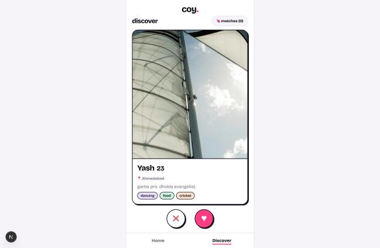
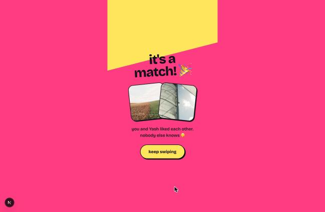

# coy · discover

A swipe-based "Discover" tab for the Coy SDE intern assignment (Part B). Next.js (App Router) + TypeScript + Tailwind + Framer Motion, with Postgres (Neon in production, embedded PGlite locally) behind Next.js API routes. A single hardcoded user (`"me"`), no auth. The "Home" tab is intentionally blank.

| Discover | It's a match |
|---|---|
|  |  |

## Run it

```bash
npm install
npm run dev     # http://localhost:3000 (next free port if busy)
npm test        # vitest: match logic
```

With no `DATABASE_URL`, the app uses an embedded Postgres (PGlite) stored in `data/`, so there's nothing to set up. Swipes and matches persist across reloads. Reset the demo with `GET /api/reset` (disabled in production unless `ALLOW_RESET=true`).

## Deploy (Vercel + Neon)

1. Create a free Postgres database on [Neon](https://neon.tech) and copy its (pooled) connection string.
2. Import this repo in Vercel and add env vars: `DATABASE_URL` and, optionally, `ALLOW_RESET=true`.
3. Deploy. Tables are created and seeded automatically on the first request.

Seed: 31 profiles, 9 of which have already liked you. Photos are seeded picsum placeholders.

## Using it

- Drag a card right to like, left to pass (touch or mouse). LIKE / NOPE stamps fade in with the drag.
- Or use the ✕ / ♥ buttons, or the ← / → arrow keys.
- "matches" (top right) lists mutual matches.

## API

| Endpoint | Description |
|---|---|
| `GET /api/feed` | `{ profiles }` not yet swiped on, stable shuffled order. |
| `POST /api/swipe` | Body `{ targetId, direction: "like" \| "pass" }` → `{ matched: boolean, match?: Profile }`. 400 on bad input, 404 on unknown profile. |
| `GET /api/matches` | `{ matches }` mutual matches only, newest first. |
| `GET /api/reset` | Dev only (or `ALLOW_RESET=true`). Wipes and re-seeds. |

Profile: `{ id, name, age, photo, bio, city, interests[] }`.

## Privacy decisions

The promise: nobody learns who liked them unless it's mutual.

- **Feed has no like info.** Profiles are selected with an explicit column list, so there's no `likedMe` flag. Liked-me profiles look identical to the rest, and the order is a fixed shuffle so they aren't clustered at the front (tested).
- **Inbound likes live in their own `likes` table**, never returned by any endpoint; only consulted inside the swipe transaction.
- **Swipe responses are uniform for non-matches.** A pass, and a like on someone who hasn't liked you, both return `{ matched: false }`.
- **Passes are never surfaced** and a swiped profile never reappears.
- **Matches need both sides**: created only when I like someone present in `likes`.

## Backend design

- Tables: `profiles`, `swipes`, `likes`, `matches`. `swipes` has `UNIQUE(user_id, target_id)`; `matches` has `UNIQUE(user_id, other_id)`.
- `swipe()` runs in one transaction. A repeat swipe (even in the other direction) returns the original outcome and changes nothing, so it's idempotent and can't create duplicate matches.
- Logic is in `lib/matching.ts`, separate from route handlers, and tested against an in-memory DB.

## UI notes

- Optimistic: the card leaves immediately; the match screen shows as soon as the API returns `matched: true`. If a swipe request fails, the card is put back.
- Mobile-first (375px), centred 440px column on desktop, `dvh` units.
- Theme follows app.getcoy.com: Bricolage Grotesque, pastel + hard-shadow "pop" cards.

## Layout

```
app/api/*        route handlers (feed, swipe, matches, reset)
lib/matching.ts  feed / swipe / matches logic
lib/db.ts        schema + connection (Neon / PGlite)     lib/seed.ts  mock data
components/      Discover, SwipeCard, MatchScreen, MatchesView
tests/           vitest
```
